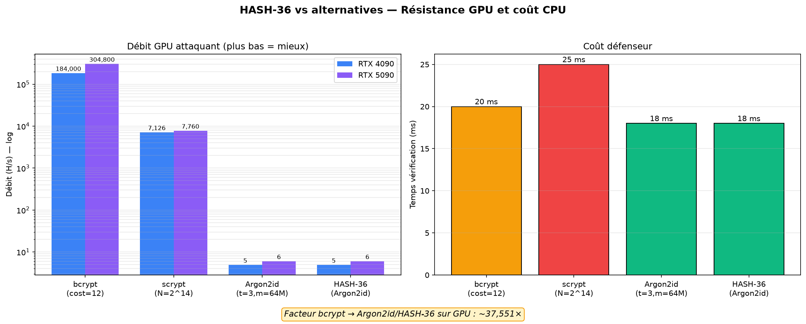
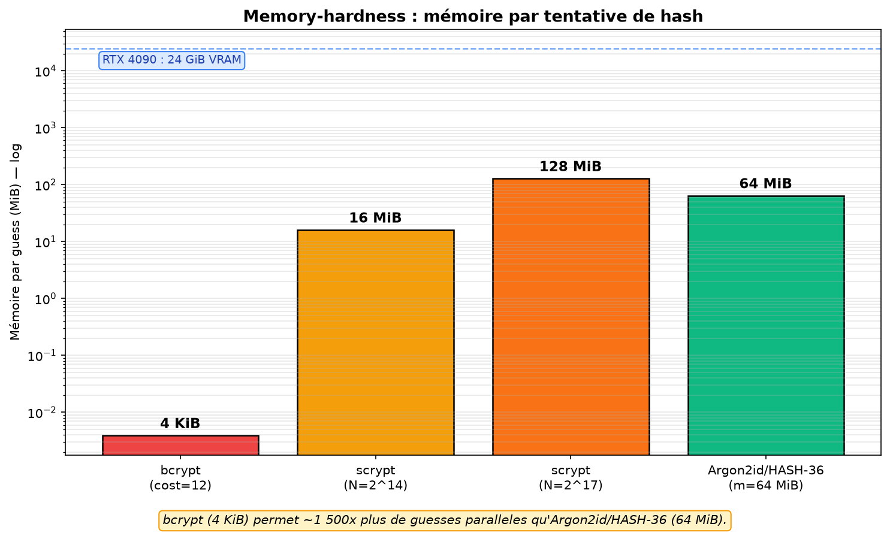

---

## ⚡whoami

**HASH-36** est un **schéma de construction** au-dessus d'**Argon2id** (RFC 9106).
Il n'invente **pas** de cryptographie : il ajoute une **séparation de domaine**, un **pepper** global et une **rotation** automatique des paramètres.

- 🔐 **Argon2id** (RFC 9106) — paramètres OWASP 2024 par défaut (`t=3, m=64 MiB, p=4`)
- 🏷️ **Domain separation** — préfixe `BASE || A1Z26` issu du mot « Hash » (A1Z26=36, BASE=2.1.19.5)
- 🌶️ **Pepper** global — protège le `tag` HMAC contre un attaquant avec accès DB
- 🔄 **Rotation** — `check_needs_rehash` + `rehash` + `rehash-all` (migration sans mot de passe)
- 🖥️ **CLI JSON** — 4 sous-commandes scriptables avec codes de sortie
- ✅ **Non-régression** — HASH-36 ≡ Argon2id bit-à-bit (8 tests)

> ⚠️ **Avertissement** : ne déployez pas HASH-36 en production sans audit de sécurité.
> Les constantes (`36`, `BASE`, couleur `#c4a47c`) sont **publiques** — elles servent à la séparation de domaine, pas à la sécurité.

---

## 🛠️tech_stack

---

## 🚀quick_start

**Installation** : `pip install hash36`

**CLI** :

    export HASH36_PEPPER="$(openssl rand -hex 32)"
    hash36 hash -P "MonMotDePasse!" --json
    hash36 verify -P "MonMotDePasse!" -r record.json --json
    hash36 rehash -P "MonMotDePasse!" -r record.json -o record.new.json
    hash36 rehash-all --dir records/ --dry-run --json

**Python** :

    from hash36_argon2id import hash36_argon2id, hash36_verify

    rec = hash36_argon2id("MonMotDePasse!")          # pepper depuis $HASH36_PEPPER
    assert hash36_verify("MonMotDePasse!", rec)

---

## 🔐paramètres_owasp

| Paramètre | Minimum | Défaut HASH-36 |
|-----------|---------|----------------|
| `t` (time cost) | 2 | **3** |
| `m` (memory cost) | 19 MiB | **64 MiB** |
| `p` (parallelism) | 1 | **4** |
| Sel | 16 octets | **16 octets** |
| Pepper | 32 octets | **variable d'env** |

---

## 📊benchmark

**Facteur bcrypt → Argon2id/HASH-36 sur GPU : ~37 000×**

| Algorithme | Débit RTX 4090 | Mémoire/guess |
|------------|----------------|---------------|
| bcrypt (cost=12) | **184 000 H/s** | 4 KiB |
| scrypt (N=2¹⁴) | 7 126 H/s | 16 MiB |
| **Argon2id / HASH-36** | **~5 H/s** | **64 MiB** |

---

## 🧪tests

**Tests rapides (11 tests)** : `pytest -v`

**Tests de timing (machine calme)** : `pytest -m slow -v -s`

**Couverture** : `pytest --cov=hash36_argon2id --cov-report=term-missing`

| Test | Ce qu'il valide |
|------|-----------------|
| `test_hash36_egal_argon2id` | HASH-36 ≡ Argon2id (bit-à-bit) |
| `test_tag_change_avec_pepper` | Le pepper protège le tag |
| `test_mode_degrade_sans_pepper` | Détection du mode dégradé |
| `test_check_needs_rehash` | Rotation correcte |
| `test_verify_bon_vs_mauvais_timing` | Timing constant (`@slow`) |
| `test_compare_digest_utilise` | `hmac.compare_digest` statique |
| `test_hash_json` / `test_verify_fail` | CLI subprocess |

---

## 🛡️threat_model

| Menace STRIDE | Risque | Contre-mesure |
|---------------|--------|---------------|
| **S**poofing | 🟡 Moyen | Argon2id irréversible, sel unique |
| **T**ampering | 🟠 sans pepper | tag HMAC-SHA3 **avec pepper** |
| **R**epudiation | ⚪ Hors périmètre | logs d'audit séparés |
| **I**nformation Disclosure | 🟢 Faible | Argon2id `m=64 MiB`, sel 128 bits |
| **D**enial of Service | 🟠 Élevé | rate-limiting (inhérent à Argon2id) |
| **E**levation | ⚪ Hors périmètre | RBAC séparé |

Voir [`docs/threat_model.md`](docs/threat_model.md) pour l'analyse complète.

---

## 🏗️architecture

- `hash36_argon2id.py` — cœur (Argon2id + pepper + rotation)
- `hash36_cli.py` — CLI (hash / verify / rehash / rehash-all)
- `pyproject.toml` — packaging PyPI (SPDX, setuptools>=77)
- `build.sh` — construction complète (tests + bench + package)
- `deploy.sh` — déploiement GitHub avec signature GPG
- `rebuild.sh` — rebuild + test dans venv vierge
- `tests/` — 3 fichiers de tests (non-régression, timing, CLI)
- `docs/threat_model.md` — STRIDE complet
- `hash36_benchmark.png` — graphique GPU + CPU
- `hash36_memory.png` — graphique memory-hardness

---

## 📈github_stats

---

## 📚références

- [RFC 9106 — Argon2](https://www.rfc-editor.org/rfc/rfc9106)
- [RFC 7914 — scrypt](https://www.rfc-editor.org/rfc/rfc7914)
- [NIST SP 800-132](https://csrc.nist.gov/publications/detail/sp/800-132/final)
- [OWASP Password Storage Cheat Sheet](https://cheatsheetseries.owasp.org/cheatsheets/Password_Storage_Cheat_Sheet.html)
- [PEP 639 — SPDX license expression](https://peps.python.org/pep-0639/)

---

## 📄licence

MIT — voir [`LICENSE`](LICENSE).

**Construit avec 🔐 par [@gunout](https://github.com/gunout)**

